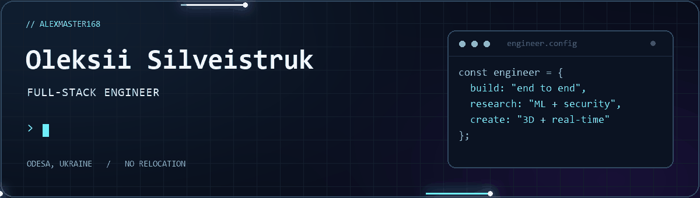

<div align="center">



### Full-Stack Engineer · Applied ML & Cybersecurity Researcher

From browser IDEs and collaborative apps to chess engines and ML-based security.

[](https://t.me/AlexMaster168)
[](https://www.linkedin.com/in/oleksii-silveistruk-03224b24b/)
[](mailto:asilvejstruk@gmail.com)

**Odesa, Ukraine · No relocation**

</div>

---

## 🧑‍💻 About Me

I build complete products end to end: interfaces, APIs, databases, real-time communication, and deployment. My work spans full-stack engineering, developer tools, 3D experiences, and applied machine learning for security.

I'm also a published researcher and a master's student in **Cybersecurity & Information Protection** at SUITT. My 2026 publications explore chess-engine search optimization and an ML-based Web Application Firewall.

```typescript
const oleksii = {
  role: "Full-Stack Engineer",
  location: "Odesa, Ukraine",
  openToRelocation: false,
  coreStack: ["TypeScript", "React", "Next.js", "Vue 3", "Node.js", "Python", "Go"],
  focus: ["Developer tools", "Real-time systems", "ML security", "3D web"],
  research: ["Game-tree search", "HTTP traffic classification"],
  education: "M.Sc. Cybersecurity & Information Protection — expected Dec 2026",
  english: "B1 · Intermediate",
};
```

---

## 🚀 Selected Projects

### Developer tools, 3D & security

| Project | What I built | Stack |
| --- | --- | --- |
| **[Online Compiler](https://github.com/AlexMaster168/online-compiler)** | Browser IDE with its own execution engine: **41 languages**, **615 auto-checked reference snippets**, a real-PTY console, and debugging for 7 languages. Includes Scratch 3 / Blockly, Arduino Uno emulation, ESP32 via QEMU, CI and nightly runs. | Django · PostgreSQL · Docker · Monaco · xterm.js · WebSocket |
| **[Chess 3D AI](https://github.com/AlexMaster168/chess-3D-ai)** | Custom TypeScript engine with alpha-beta and quiescence search, an opening book, 5 difficulty levels, and Web Worker execution. Procedural 3D board with 3 themes, Elo ratings and analytics in a four-package monorepo. Related to my chess-search research below. | TypeScript · Three.js · Vue 3 · Express · SQLite |
| **[ZTNA-ml](https://github.com/AlexMaster168/ztna-ml)** | WireGuard zero-trust panel with traffic-based trust scoring. Rules and an LSTM autoencoder detect brute force, scanning and exfiltration; the gateway quarantines nodes through nftables. Reported evaluation: **0.974 ROC-AUC**, **0.51% FPR**, **0.863 recall**. | Python · ONNX Runtime · Django REST · Next.js · Redis Streams · Docker |
| **[Mirage](https://github.com/AlexMaster168/honeypot-practicum)** | Isolated honeynet lab with Cowrie, OpenCanary and Dionaea, honeytokens, IDS, Kibana dashboards, and an event correlator mapping attack campaigns to MITRE ATT&CK. Includes a Kali attack write-up. | Vagrant · Ansible · Docker · Kibana · Python |

### Full-stack & real-time products

| Project | What I built | Stack |
| --- | --- | --- |
| **[Go Sales CRM](https://github.com/AlexMaster168/go-vue-crm)** | Order workflows with transactional stock reservation, price snapshots and status history; customer segments, review moderation, analytics, UA/EN, and Playwright tests. | Go · chi · pgx · PostgreSQL · Vue 3 · Pinia · ECharts |
| **[CollabBoard](https://github.com/AlexMaster168/miro-clone)** | Collaborative whiteboard with 12 canvas tools, draw.io-style connectors, Yjs CRDT collaboration, rich-text documents, workspaces, and a gRPC gateway. | Next.js · React · Konva · Yjs · gRPC · Drizzle |
| **[SocialNet](https://github.com/AlexMaster168/social-network)** | Social network with JWT and Google OAuth, a feed, friends, channels, WebSocket messaging, and WebRTC calls. | Next.js · Hono · WebRTC · Drizzle |
| **[Monitoring ESP32](https://github.com/AlexMaster168/monitoring-esp32)** | Sensor ingestion over MQTT, a live dashboard, and XGBoost anomaly detection and forecasting. | Spring Boot · React · MQTT · XGBoost · MySQL |
| **[Peremoga](https://github.com/AlexMaster168/ruby-donate-peremoga)** | Aid platform for Ukraine with four roles, aid tickets, fundraisers, ActionCable live updates, ActiveAdmin, a Swagger API, and UA/EN support. | Rails · Angular · PostgreSQL · JWT |

<details>
<summary><b>More projects: games, learning platforms & web apps</b></summary>

- **[Hogwarts Mini](https://github.com/AlexMaster168/hogwarts-game)** — Unity 6 action RPG with 36 story stages, 15 spells, 14 enemy types, and 22 castle zones. Other Unity projects include *Soul Knight Clone* and *Lullaby of Echoes*.
- **[Music Platform](https://github.com/AlexMaster168/music-platform)** — NestJS and Next.js.
- **[LangLearn](https://github.com/AlexMaster168/coursehub)** — ASP.NET Core and Angular.
- **[Mini Excel](https://github.com/AlexMaster168/excel-js)** — TypeScript spreadsheet project.
- **[Video Chat](https://github.com/AlexMaster168/video-chat)** — WebRTC communication.
- **[EduLink](https://github.com/AlexMaster168/coursera)** — URL shortener and LMS.
- **[КупиДевайс](https://github.com/AlexMaster168/pern-stack)** — PERN e-commerce.
- **[Shop](https://github.com/AlexMaster168/node-shops)** — Hono and Redis.
- **[Checkers AI](https://github.com/AlexMaster168/checkers-ai)** — another game AI project.

[Explore my repositories →](https://github.com/AlexMaster168?tab=repositories)

</details>

---

## 🔬 Research & Publications

### ♟️ Chess-engine search optimization · Journal article, 2026

**Optimization of the Minimax Algorithm with Alpha-Beta Pruning for Chess Artificial Intelligence Systems**
O. R. Silveistruk · *Informatics. Culture. Technology*, Vol. 3, No. 1 (3), pp. 179–188 · September 2026 · Ukrainian

A Python minimax engine extended with iterative deepening, Zobrist-hashed transposition tables, MVV-LVA move ordering, killer/history heuristics, and quiescence search.

- **≈120× fewer evaluated nodes** at depth 5.
- Decision time reduced from **92.4 s to 0.43 s** in the reported evaluation.
- Up to **96.5% wins at level 0** against a reference engine in the reported setup.

[DOI: 10.15276/ict.03.2026.15](https://doi.org/10.15276/ict.03.2026.15) · [Article](https://ict.od.ua/index.php/journal/article/view/130) · [PDF](https://ict.od.ua/index.php/journal/article/download/130/124)

### 🛡️ ML-based Web Application Firewall · Conference paper, 2026

**A System for Filtering HTTP Traffic of Web Applications (WAF) Using Machine Learning**
O. R. Silveistruk · *Perspective Directions of Information Protection*, VIII International Scientific-Practical Conference · Odesa, August 26–28, 2026 · pp. 106–109 · Ukrainian

An intelligent reverse-proxy WAF using 51-feature request vectors, including Shannon entropy, SMOTE balancing, and an XGBoost / Random Forest / SVM / MLP ensemble with hybrid signature cross-validation.

- **99.76% accuracy** and **0.34% false positives** on 12,000 fuzzed transactions.
- **14.8 ms p99 latency at 1,500 RPS** in the reported evaluation.

[Proceedings, pp. 106–109](https://suitt.edu.ua/wp-content/uploads/2026/09/proceedings_atis-1.pdf) · [Certificate](https://imgur.com/a/M4BmmQq)

<details>
<summary><b>Earlier conference papers · 2024–2026</b></summary>

| Conference | Date | Pages |
| --- | --- | --- |
| [Current Trends in Scientific Research Development · Boston](https://sci-conf.com.ua/v-mizhnarodna-naukovo-praktichna-konferentsiya-current-trends-in-scientific-research-development-12-14-12-2024-boston-ssha-arhiv/) | Dec 2024 | 269–274 |
| [European Congress of Scientific Achievements · Barcelona](https://sci-conf.com.ua/xii-mizhnarodna-naukovo-praktichna-konferentsiya-european-congress-of-scientific-achievements-2-4-12-2024-barselona-ispaniya-arhiv/) | Dec 2024 | 206–210 |
| [79th SUITT Scientific-Technical Conference](https://suitt.edu.ua/wp-content/uploads/2025/01/zbirnyky_materialiv_79_i_naukovo_tekhnichnoi_konferentsii_profesorsko-1.pdf) | Nov 2024 | 185–187 |
| [80th SUITT Scientific-Technical Conference](https://suitt.edu.ua/wp-content/uploads/2026/03/zbirnyk-tez-duitz-80-mntk.pdf) | Feb 2026 | 296–300 |

</details>

---

## 🛠️ Tech Stack


<details>
<summary><b>Explore by domain</b></summary>

| Domain | Technologies |
| --- | --- |
| **Frontend & 3D** | TypeScript, React, Next.js, Vue 3, Angular, Redux, Three.js, Tailwind CSS |
| **Backend & APIs** | Node.js, Go, NestJS, Express, Hono, Django, Flask, Rails, Spring Boot, ASP.NET Core, REST, GraphQL, gRPC |
| **Real-time & IoT** | WebRTC, Socket.IO, WebSocket, Yjs CRDT, MQTT |
| **Data & ML** | Python, NumPy, Pandas, scikit-learn, XGBoost, TensorFlow, PyTorch, Matplotlib |
| **Databases** | PostgreSQL, MySQL, MongoDB, SQLite, Redis, Firebase, Drizzle |
| **Security** | Pentesting, OWASP Top 10, WAF, traffic analysis, Burp Suite, Nmap, Wireshark, Snyk, Semgrep, SonarQube |
| **Tools & games** | Docker, Git, GitHub Actions, Vite, Jest, Unity / C# |

</details>

---

## 💼 Experience

| Role / activity | Organization | Period | Work |
| --- | --- | --- | --- |
| **Junior Frontend Developer** | Asferro | Jan–Feb 2022 | Migrated an admin dashboard from GraphQL Apollo to REST in a full-stack team. |
| **Production Intern** | ISyb | Feb–Mar 2024 | Built a full-stack auto-parts e-commerce site with React, Node.js and TypeScript. |
| **Student Project · Ukrainian YouTube** | Science Skills Booster SUITT | 2024 | Key team member on a content-sharing platform with React/Next.js, NestJS, PostgreSQL, JWT, video upload and social features. |
| **Freelance** | Multiple clients | — | Built e-commerce websites. |

**Training:** [EPAM Systems · Front-End Fundamentals](https://certificates.epam.com/certificates/48d24a68-d577-4717-b7aa-bde35710ada3), February–March 2025 — completed course and earned a certificate.

---

## 🎓 Education

| Degree | Institution | Timeline |
| --- | --- | --- |
| **M.Sc. Cybersecurity & Information Protection** | State University of Intelligent Technologies and Communications | Sep 2025–Dec 2026 · expected |
| **B.Sc. Computer Science** | State University of Intelligent Technologies and Communications | Graduated 2025 · score 100 |

**Community:** [Science Skills Booster SUITT 2024](https://suitt.edu.ua/2024/05/23/science-skills-booster-suitt-2024-pochatok-pokladeno/) · [Innovation Hub project presentations](https://suitt.edu.ua/2023/12/22/vidbuvsia-zakhid-pid-nazvoiu-khab-innovatsijnykh-proiektiv-duitz/)

---

## 📊 GitHub Stats

<div align="center">

[](https://github.com/AlexMaster168)

[](https://github.com/AlexMaster168)

</div>

---

<div align="center">

### Have a product to build or a research idea to explore?

[Let's talk →](mailto:asilvejstruk@gmail.com)


</div>
